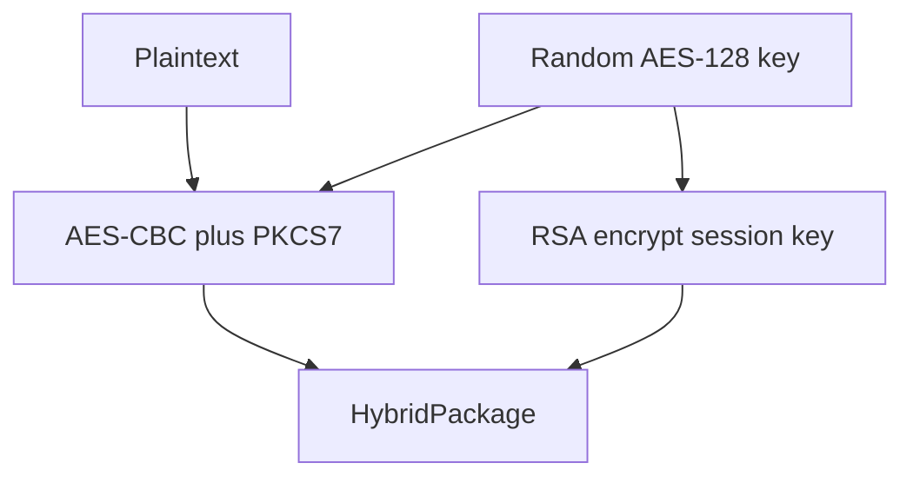

# Project design: AES-128 and RSA

CSCI 663 group project. The two schemes are AES and RSA, joined later as a hybrid cryptosystem: RSA wraps a random AES-128 session key, and AES-CBC encrypts the message. Algorithms are implemented in Python from the specifications. PyCryptodome and similar libraries are not used.

This document is the Week 3 design. The Week 5 slice (field arithmetic, the AES block cipher, and RSA number theory) is already implemented and covered by passing unit tests. Everything else is a stub with a skipped test that states the expected behavior.

## Milestones and who picks up what

| Week | State in this repo | Owner |
| --- | --- | --- |
| 3 | This design, package layout, unit tests, system-test file | Done |
| 5 | AES-128 block cipher and RSA `extended_gcd` / `modinv` / `modexp` | Done |
| 7 | AES-CBC and PKCS#7 (`src/cryptosystem/aes/modes.py`) | Next teammate |
| 9 | Text/file helpers and the Streamlit AES page (`app.py`) | Same teammate, through the first scheme |
| 11 | RSA primes, key generation, textbook encrypt/decrypt, PKCS#1 v1.5 | Other teammate |
| 13 | Hybrid package and one GUI with AES, RSA, and hybrid pages | Return to this after the two schemes exist |
| 15 | Recorded group presentation | Whole group |

## Layout

```
app.py                                 Streamlit entry point (stub)
src/cryptosystem/aes/field.py          GF(2^8): xtime, gf_mul, gf_inv
src/cryptosystem/aes/sbox.py           S-box built from the field inverse
src/cryptosystem/aes/rounds.py         SubBytes, ShiftRows, MixColumns, AddRoundKey
src/cryptosystem/aes/key_schedule.py   expand_key(key, nk=None)
src/cryptosystem/aes/cipher.py         encrypt_block, decrypt_block
src/cryptosystem/aes/modes.py          CBC, PKCS#7, text/file helpers (stub)
src/cryptosystem/rsa/number_theory.py  extended_gcd, modinv, modexp
src/cryptosystem/rsa/rsa.py            RSAKey plus the scheme (stub)
src/cryptosystem/hybrid.py             HybridPackage plus encrypt/decrypt (stub)
tests/fips197.py                       Published FIPS-197 vectors
tests/unit/                            One module per area
tests/system/test_hybrid.py            End-to-end scenario, currently skipped
```

A 16-byte AES state uses FIPS-197 input order. The byte at row `r` and column `c` is at index `r + 4 * c`. Callers pass blocks in that order already, which is the order of the NIST known-answer tests.

## AES

`Nk` is the key length in 32-bit words. AES-128 uses `Nk = 4` (10 rounds). `expand_key` also accepts `Nk = 6` and `Nk = 8` so AES-192 and AES-256 do not need a second schedule. The course tests are AES-128 only.

Implemented now:

- `xtime(value)`, `gf_mul(left, right)`, `gf_inv(value)` in GF(2^8) with modulus `0x11B`
- `sbox_lookup` / `inv_sbox_lookup`, derived as the FIPS-197 affine map of the multiplicative inverse, then cached
- `sub_bytes`, `shift_rows`, `mix_columns`, `add_round_key`, and `inv_sub_bytes`, `inv_shift_rows`, `inv_mix_columns`
- `expand_key(key, nk=None) -> list[bytes]` of `Nr + 1` round keys
- `encrypt_block(plaintext, key)` and `decrypt_block(ciphertext, key)`

The inverse cipher uses the encryption round keys. InvMixColumns is applied to the state, not to the keys.

Checked vectors:

- FIPS-197 section 4.2.1: `{57} * {02} = {ae}`, `{57} * {13} = {fe}`
- FIPS-197 Figure 7, first S-box row: `63 7c 77 7b f2 6b 6f c5 30 01 67 2b fe d7 ab 76`
- Appendix A.1 key expansion and the Appendix B round-1 trace for key `2b7e151628aed2a6abf7158809cf4f3c`
- Appendix B ciphertext `3925841d02dc09fbdc118597196a0b32`
- Appendix C.1: plaintext `00112233445566778899aabbccddeeff`, key `000102030405060708090a0b0c0d0e0f`, ciphertext `69c4e0d86a7b0430d8cdb78070b4c55a`

Left for Weeks 7–9, specified in `modes.py` and `tests/unit/test_modes.py`:

- `pkcs7_pad` / `pkcs7_unpad`. Padding length `n` is `1..block_size`, and every padding byte equals `n`. A full block still gains a whole extra block.
- `encrypt_cbc` / `decrypt_cbc` with no padding. `C_1 = AES(P_1 XOR iv)` and `C_i = AES(P_i XOR C_{i-1})`. The known answer is NIST SP 800-38A appendix F.2.1.
- `encrypt_text` / `decrypt_text`: UTF-8, then PKCS#7, then CBC.
- `encrypt_file` / `decrypt_file`: the same for raw bytes.

The GUI takes a 32-hex-character AES-128 key and a plaintext string. There is no password key-derivation function.

## RSA

Implemented now in `number_theory.py`. All three are iterative, so a 1024-bit modulus will not hit the recursion limit:

- `extended_gcd(a, b) -> (g, x, y)` with `g = gcd(a, b) >= 0` and `a*x + b*y = g`
- `modinv(value, modulus)` in `0 .. modulus-1`
- `modexp(base, exponent, modulus)` by square-and-multiply

Textbook check, `p = 61`, `q = 53`, `n = 3233`, `phi = 3120`, `e = 17`, `d = 2753`:

- `extended_gcd(240, 46) == (2, -9, 47)`
- `modinv(17, 3120) == 2753`
- `modexp(65, 17, 3233) == 2790`

Left for Week 11, specified in `rsa.py` and `tests/unit/test_rsa.py`:

- `RSAKey(n, e, d=None, p=None, q=None)` is already a frozen dataclass. `byte_length` is `(n.bit_length() + 7) // 8`.
- `is_probable_prime(n, rounds=40, rng=None)`: Miller-Rabin. `False` for `n < 2` and for even `n` other than 2.
- `generate_prime(bits)`: a probable prime with exactly `bits` bits.
- `generate_keypair(bits=1024, e=65537)`: `bits` even and at least 32. `p` and `q` each have `bits // 2` bits. The private exponent is `modinv(e, (p - 1) * (q - 1))`, the Euler totient inverse, not the Carmichael lambda inverse.
- `encrypt_int` / `decrypt_int`: textbook RSA, `0 <= message < n`. The vector above encrypts 65 to 2790.
- `pkcs1_v15_pad` / `pkcs1_v15_unpad`: RFC 8017 block type 2, `0x00 || 0x02 || PS || 0x00 || M`, at least 8 nonzero padding bytes.
- `encrypt` / `decrypt`: pad to `byte_length`, exponentiate, return a big-endian byte string of that length.

The demo modulus is about 1024 bits. Unit tests may pass a smaller even `bits` so they stay fast. The GUI shows `n`, `e`, and `d`.

## Hybrid



`HybridPackage` stores lowercase hex fields `wrapped_key`, `iv`, and `ciphertext`. `iv` is 16 bytes (32 hex characters). `wrapped_key` is the PKCS#1 encryption of the 16-byte session key, so its hex length is `2 * public_key.byte_length`. `encrypt_file` produces `ciphertext`.

`tests/system/test_hybrid.py` is the whole-system test. It generates a 1024-bit key, encrypts `b"hybrid encryption demo"`, checks the three hex fields, and decrypts back to the same bytes. It stays skipped until Week 13.

## GUI

`app.py` is the Streamlit entry point and currently raises `NotImplementedError`. One app, three pages:

- AES: 32 hex characters for the key, plaintext in, ciphertext hex out, and the reverse.
- RSA: generate a key pair, show `n`, `e`, and `d`, encrypt and decrypt a short integer or a short byte string.
- Hybrid: generate or paste an RSA key, type a message, show the package, and recover the message.

Run the finished app with `streamlit run app.py`.

## Tests

`pytest` is the runner. Active tests must pass. Skipped tests are the written contract for later weeks; delete the `@pytest.mark.skip` line when the function exists. Failing tests are not an acceptable way to mark unfinished work.

| Test module | Week | Status |
| --- | --- | --- |
| `tests/unit/test_field.py` | 5 | passing |
| `tests/unit/test_sbox.py` | 5 | passing |
| `tests/unit/test_rounds.py` | 5 | passing |
| `tests/unit/test_key_schedule.py` | 5 | passing |
| `tests/unit/test_aes_block.py` | 5 | passing |
| `tests/unit/test_number_theory.py` | 5 | passing |
| `tests/unit/test_modes.py` | 7 and 9 | skipped |
| `tests/unit/test_rsa.py` | 11 | skipped, except `RSAKey.byte_length` |
| `tests/system/test_hybrid.py` | 13 | skipped |
